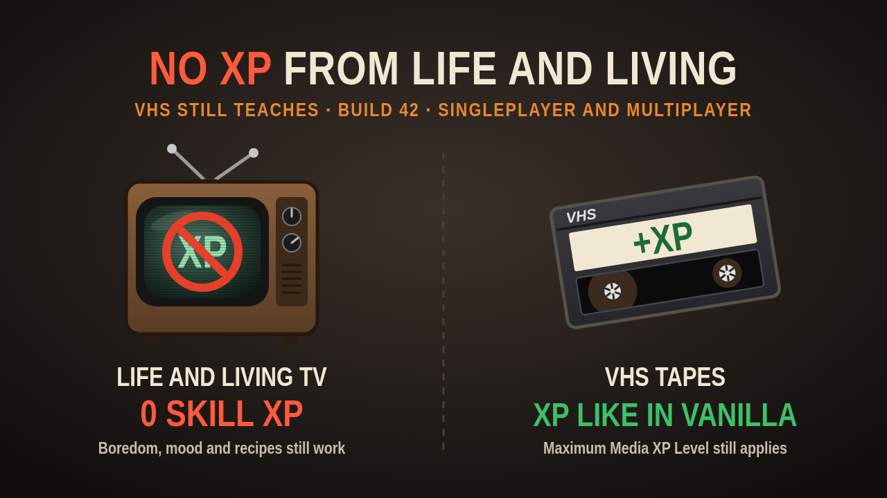

# No XP From Life and Living (VHS Still Teaches)

A small Project Zomboid **Build 42** mod. The *Life and Living* TV channel no longer gives skill XP, while VHS tapes
and CDs keep working exactly like in vanilla.

Steam Workshop: https://steamcommunity.com/sharedfiles/filedetails/?id=3823361912 (Mod ID `NoTVXP`)

## Why

The game has a single sandbox option for all media XP, *Maximum Media XP Level*. You cannot switch off the free XP
from the first-days *Life and Living* shows without turning off VHS tapes as well. This mod splits the two.

## What changes

- **Life and Living:** skill XP is removed. Boredom, mood and recipes from the shows still apply. The same goes for
  any other TV or radio broadcast with skill XP, including channels added by mods (in vanilla only Life and Living
  has any).
- **VHS tapes and CDs:** unchanged and still limited by *Maximum Media XP Level*. Tapes added by other mods keep their
  XP too.
- A line you have already heard still counts as heard, like in vanilla.
- Singleplayer and multiplayer. Safe to add to or remove from an existing save. No items, no sandbox options.

## How it works

`Contents/mods/NoTVXP/42/media/lua/shared/NoTVXP.lua` wraps the game's own handler for device text
(`ISRadioInteractions`, event `OnDeviceText`). Lines from recorded media (VHS, CD) carry a guid from the recorded
media list (`RM_…` in vanilla, or any key registered in `RecMedia` by another mod) and pass unchanged. For broadcast
lines the skill codes (`CRP+1`, `COO+2`, …) are dropped and the rest (boredom, mood, recipes) is kept. No game file
is replaced.

## Install by hand

Copy this folder to `Zomboid/Workshop/NoTVXP` (or `Contents/mods/NoTVXP` to `Zomboid/mods/NoTVXP`) and enable the mod
in the game. The Workshop version is the easier way.

## License

Free and open source under the [GNU GPL v3 or later](LICENSE). You may use, change and re-upload this mod, also as
part of your own mod or modpack, as long as your version is released under the same license with its source open to
everyone. Please keep the license notice in the files. A credit or a link back is appreciated, but not required.

Made with the help of Claude Code.
